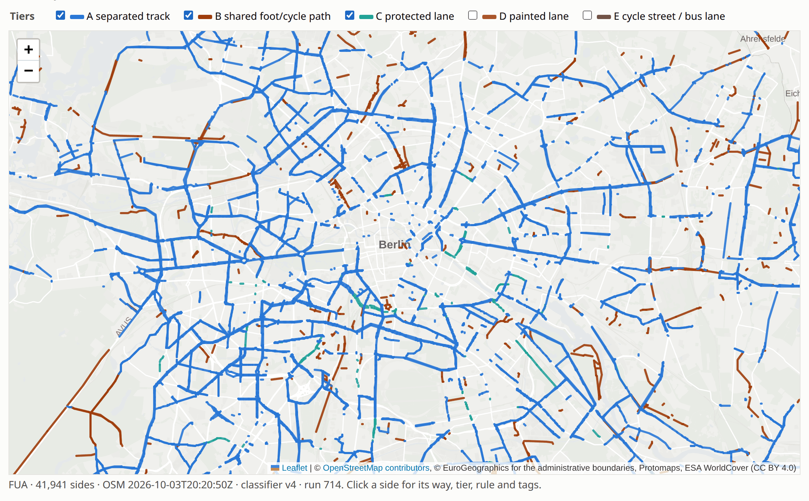
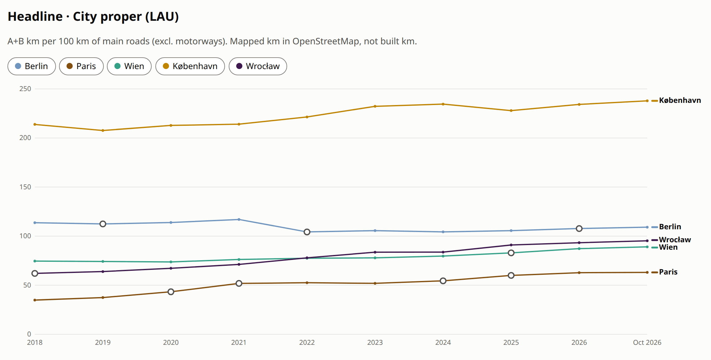

# velometer

Measures protected cycling infrastructure in 21 European cities from OpenStreetMap, year by year
since 2018, with every rule and number reproducible.

[](LICENSE)
[](docs/adr/0008-licences.md)
[](pyproject.toml)

Auf Deutsch: Ergebnisse und Hintergründe für Berlin im [Zählwerk Berlin Datalab](https://zaehlwerk-datalab.de/).

<p align="center">
  <picture>
    <source media="(prefers-color-scheme: dark)" srcset="docs/img/readme/tiermap-berlin-dark.png">
    
  </picture>
</p>

<p align="center">
  <a href="https://velometer.zaehlwerk-datalab.de/">Explore the results</a> ·
  <a href="docs/methodology.md">Methodology</a> ·
  <a href="docs/adr/">Decisions</a> ·
  <a href="https://zaehlwerk-datalab.de/">Datalab (Deutsch)</a>
</p>

> [!NOTE]
> All lengths are **mapped km**: what OpenStreetMap contributors have mapped, not what a city has
> built ([ADR 0006](docs/adr/0006-mapped-km-not-built-km.md)). Mapping is more complete in some
> cities and years than in others, so a gap between two cities can be a gap in the map.

## Why

Published cycling rankings disagree, and most of them can't be re-run: some mix figures the cities
submit with OSM data and publish no code, others are expert scores. velometer is a pipeline anyone
can run. It produces per-city numbers with explicit definitions, and it shows *why* rankings
disagree (definitions, denominators, boundaries) instead of hiding it.

## What it does

- **Classifies** every side of every road in OSM into one of five tiers, from A (separated cycle
  track) to E (cycle street or bus lane). The rules derive from the ECF's QECIO tag logic and live
  as data in [`config/classifier/`](config/classifier/); a rule change is a new classifier version.
- **Measures** lengths in each city's projected coordinate system, never in degrees, inside two
  boundaries: the city proper (LAU) and its functional urban area (FUA).
- **Goes back in time** with yearly snapshots on 1 January from 2018, cut from OSM's full history,
  plus a current snapshot. Every result row records its classifier version and OSM timestamp.
- **Compares** its own numbers with official city figures and published rankings, which stay a
  separate layer and are never blended in ([ADR 0001](docs/adr/0001-self-built-osm-pipeline-is-primary.md)).
- **Publishes** a static, bilingual reader site: per-city pages with charts and tier maps, a compare
  view, stories, sources, and CSV and GeoJSON downloads, each carrying its attribution.

The headline metric is **A+B km per 100 km of main roads** (separated tracks plus shared foot and
cycle paths, against the main road network without motorways; [ADR 0003](docs/adr/0003-headline-metric-main-road-denominator.md)).

<p align="center">
  <picture>
    <source media="(prefers-color-scheme: dark)" srcset="docs/img/readme/compare-headline-dark.png">
    
  </picture>
</p>

<sub>The compare view: headline metric, city proper, OSM snapshot of 3 October 2026, classifier v4.</sub>

## Quick start

You need [uv](https://docs.astral.sh/uv/) and [osmium-tool](https://osmcode.org/osmium-tool/)
(`apt install osmium-tool`).

```bash
git clone https://github.com/senzelden/velometer.git && cd velometer
uv sync
uv run velometer init                   # SQLite schema and the 21 cities
uv run velometer run --cities ljubljana # download, clip, classify, store
uv run velometer results                # one row per city
```

The run takes about a minute, most of it the Slovenia download. `results` then prints (abridged):

```
city       osm_date    headline  ecf_qecio  clean_cities  A_km   B_km  C_km  D_km   E_km  main_km
ljubljana  2026-10-27  72.7      41.8       20.7          205.7  36.7  0.0   101.7  1.8   333.2
```

`headline` is A+B km per 100 km of main roads; `ecf_qecio` and `clean_cities` are the same city
measured by those rankings' definitions.

A full run downloads one Geofabrik extract per country. The yearly history needs a free OSM
account for Geofabrik's full-history files (`velometer auth`). `uv run velometer --help` lists
everything else: reconciliation with external figures, time series, trust diagnostics, counters,
plan networks and the static export (`velometer app export`).

## Cities and sources

| | |
|---|---|
| **Cities** | Amsterdam, Barcelona, Berlin, Bordeaux, Bratislava, Budapest, København, Helsinki, Kraków, Ljubljana, Lyon, Madrid, Oslo, Paris, Praha, Stockholm, Strasbourg, Utrecht, Warszawa, Wien, Wrocław |
| **Infrastructure** | OpenStreetMap via [Geofabrik](https://download.geofabrik.de/) extracts, current and full history |
| **Boundaries** | Eurostat GISCO, LAU 2024 and FUA |
| **Population** | Eurostat, INSEE (France), INE (Spain) |
| **Context** | Open bike-counter data (Berlin, Paris, Wien, Helsinki, Madrid, Barcelona, Oslo), Berlin's cycling plan network |
| **Comparison only** | Official city figures, Clean Cities 2025, Copenhagenize, ECF QECIO, BikeNetKit; cited with source and date, never redistributed |
| **Basemap** | [Protomaps](https://protomaps.com/) extract, served from our own host |

## How to read the numbers

- **Mapped, not built.** A rise can be new infrastructure or new mapping. velometer diagnoses
  mapping effort per country (`velometer trust`) instead of correcting it away.
- **Flagged years.** Jumps that an automatic check catches are flagged in every chart, and each
  flag carries a written explanation.
- **Boundaries matter.** The city proper and the wider urban area tell different stories; both are
  computed, the city proper is the default.
- **Definitions are presets.** "Protected" means different tier sums in different rankings; the
  presets in [`config/presets.yaml`](config/presets.yaml) reproduce them side by side.

The full method, generated from the config and the database and checked for staleness, is in
[`docs/methodology.md`](docs/methodology.md). The decisions behind it are the
[ADRs](docs/adr/).

## Development

```bash
uv run ruff format --check . && uv run ruff check . && uv run pytest \
  && node --test "src/velometer/app/static/js/tests/*.test.mjs"
```

Network tests are marked `slow` and deselected by default. Deployment of the static edition is in
[`docs/deploy.md`](docs/deploy.md). The images in this README are rendered from the site by
[`tools/readme_shots.py`](tools/readme_shots.py).

## Citation

Use GitHub's "Cite this repository" button ([`CITATION.cff`](CITATION.cff)), and name the
classifier version and OSM snapshot of the figures you cite: the Cite block under each chart on
the site gives both, ready to copy.

## Licences and attribution

| Part | Licence |
|---|---|
| Code and classifier rules | [MIT](LICENSE) |
| Derived data: tier lengths, metrics, CSV and GeoJSON downloads | [ODbL 1.0](https://opendatacommons.org/licenses/odbl/1-0/), map data © [OpenStreetMap contributors](https://www.openstreetmap.org/copyright) |
| Administrative boundaries | © EuroGeographics for the administrative boundaries (non-commercial use) |
| Counter data | Each publisher's licence (dl-de-zero-2.0, ODbL, CC BY 4.0, NLOD), credited on every page that shows it |
| External comparison figures | Cited with source URL and retrieval date, not relicensed |

Each licence, its credit line and where it appears are recorded in
[ADR 0008](docs/adr/0008-licences.md).
