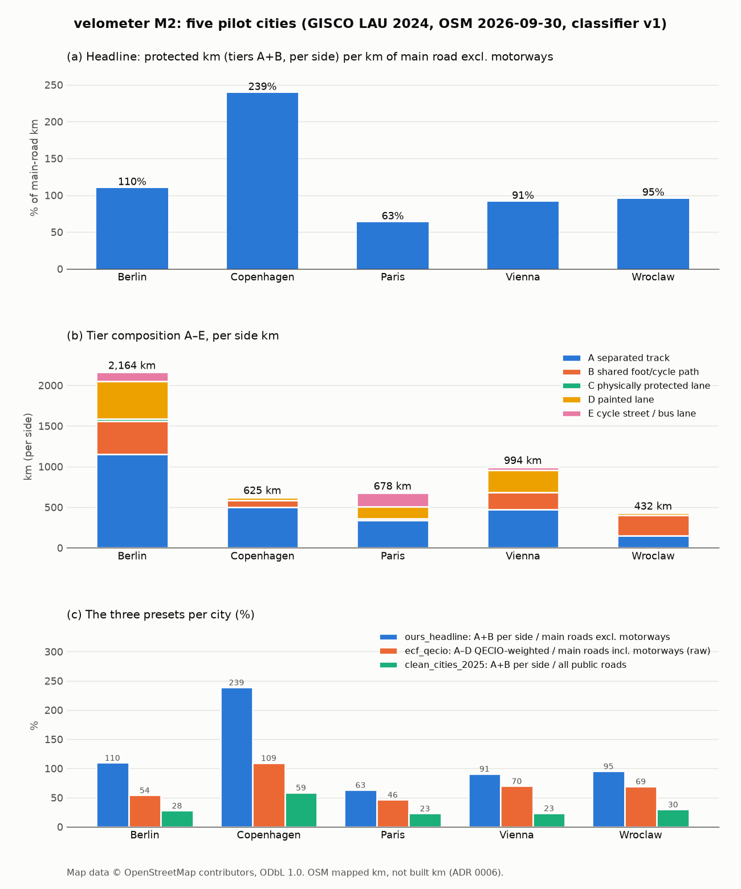

# M2 results: five pilot cities

Generated by `scripts/render_m2_results.py` from `velometer.sqlite` (latest done `lau` run per city). OSM data: © OpenStreetMap contributors, ODbL 1.0; our tier lengths and metrics are derived data under ODbL 1.0 (ADR 0008). Lengths are OSM *mapped* km (ADR 0006), measured in each city's projected EPSG.

## Results

Headline and preset values are percentages (numerator km / denominator km × 100); tier km are per side (each side of a road counts once). Per-100k is the headline numerator km per 100,000 residents. A per-side headline passes 100% when main roads have tracks on both sides, and can pass 200% because tracks along residential streets and standalone paths count in the numerator but not in the main-road denominator.

| city | osm_date | headline % | ecf_qecio % | clean_cities % | A km | B km | C km | D km | E km | main km | headline km/100k |
|---|---|---:|---:|---:|---:|---:|---:|---:|---:|---:|---:|
| berlin | 2026-09-30 | 109.6 | 54.0 | 27.7 | 1,151.2 | 406.7 | 28.9 | 461.6 | 115.2 | 1,421.0 | 41.2 |
| copenhagen | 2026-09-30 | 238.8 | 109.3 | 58.6 | 498.4 | 83.9 | 0.0 | 36.5 | 6.3 | 243.9 | 88.3 |
| paris | 2026-09-30 | 63.1 | 46.5 | 22.9 | 335.1 | 21.4 | 0.0 | 147.1 | 174.8 | 565.3 | 17.1 |
| vienna | 2026-09-30 | 91.0 | 69.8 | 23.2 | 474.7 | 205.1 | 0.0 | 273.2 | 41.1 | 747.4 | 33.9 |
| wroclaw | 2026-09-30 | 95.3 | 69.3 | 29.7 | 148.7 | 250.0 | 0.1 | 32.3 | 0.8 | 418.5 | 59.2 |

## Presets

| city | preset | basis | value % | numerator km | denominator km |
|---|---|---|---:|---:|---:|
| berlin | `ours_headline` | per_side | 109.6 | 1,557.9 | 1,421.0 |
| berlin | `ecf_qecio` | qecio_weighted | 54.0 | 1,163.6 | 2,153.4 |
| berlin | `clean_cities_2025` | per_side | 27.7 | 1,557.9 | 5,624.1 |
| copenhagen | `ours_headline` | per_side | 238.8 | 582.3 | 243.9 |
| copenhagen | `ecf_qecio` | qecio_weighted | 109.3 | 378.2 | 346.0 |
| copenhagen | `clean_cities_2025` | per_side | 58.6 | 582.3 | 992.9 |
| paris | `ours_headline` | per_side | 63.1 | 356.5 | 565.3 |
| paris | `ecf_qecio` | qecio_weighted | 46.5 | 317.0 | 682.1 |
| paris | `clean_cities_2025` | per_side | 22.9 | 356.5 | 1,555.8 |
| vienna | `ours_headline` | per_side | 91.0 | 679.8 | 747.4 |
| vienna | `ecf_qecio` | qecio_weighted | 69.8 | 750.3 | 1,075.2 |
| vienna | `clean_cities_2025` | per_side | 23.2 | 679.8 | 2,926.7 |
| wroclaw | `ours_headline` | per_side | 95.3 | 398.6 | 418.5 |
| wroclaw | `ecf_qecio` | qecio_weighted | 69.3 | 395.2 | 570.7 |
| wroclaw | `clean_cities_2025` | per_side | 29.7 | 398.6 | 1,340.5 |

## Provenance

Classifier: `v1` with parameters `{"plain_cycleway_on_oneway":"traffic_side"}` (`config/classifier/`).

| city | run | OSM timestamp | Geofabrik md5 | git commit | boundary | area km² | population | population source |
|---|---:|---|---|---|---|---:|---:|---|
| berlin | 1 | 2026-09-30T20:22:42Z | `d9f43a4a` | `2e90435` | Eurostat GISCO, LAU 2024 (1:1M) | 892.3 | 3,782,202 (2024) | GISCO LAU 2024 POP_2024 |
| copenhagen | 4 | 2026-09-30T20:22:42Z | `ba5b1ed1` | `2e90435` | Eurostat GISCO, LAU 2024 (1:1M) | 94.9 | 659,350 (2024) | GISCO LAU 2024 POP_2024 |
| paris | 2 | 2026-09-30T20:22:42Z | `cf264dbe` | `2e90435` | Eurostat GISCO, LAU 2024 (1:1M) | 105.3 | 2,084,894 (2024) | Eurostat demo_r_pjangrp3 FR101 2024 |
| vienna | 3 | 2026-09-30T20:22:42Z | `74212346` | `2e90435` | Eurostat GISCO, LAU 2024 (1:1M) | 413.9 | 2,005,760 (2024) | GISCO LAU 2024 POP_2024 |
| wroclaw | 5 | 2026-09-30T20:22:42Z | `0ab5acc3` | `2e90435` | Eurostat GISCO, LAU 2024 (1:1M) | 291.6 | 673,743 (2024) | GISCO LAU 2024 POP_2024 |

## Completeness (share of tier km with the tag)

Length-weighted per tier and side. `segregated` is meaningful only for tier B.

| city | tier | width | surface | segregated |
|---|---|---:|---:|---:|
| berlin | A | 67% | 83% | 20% |
| berlin | B | 67% | 98% | 98% |
| berlin | C | 91% | 73% | 1% |
| berlin | D | 54% | 49% | 0% |
| berlin | E | 60% | 54% | 0% |
| copenhagen | A | 15% | 29% | 10% |
| copenhagen | B | 8% | 96% | 79% |
| copenhagen | D | 1% | 0% | 0% |
| copenhagen | E | 20% | 95% | 0% |
| paris | A | 27% | 90% | 8% |
| paris | B | 6% | 95% | 90% |
| paris | D | 2% | 0% | 0% |
| paris | E | 1% | 5% | 0% |
| vienna | A | 27% | 90% | 67% |
| vienna | B | 9% | 94% | 93% |
| vienna | D | 1% | 0% | 0% |
| vienna | E | 6% | 50% | 1% |
| wroclaw | A | 13% | 95% | 0% |
| wroclaw | B | 5% | 94% | 98% |
| wroclaw | C | 0% | 0% | 0% |
| wroclaw | D | 0% | 1% | 0% |
| wroclaw | E | 0% | 0% | 0% |

## Attribution

Map data © OpenStreetMap contributors, ODbL 1.0 (https://www.openstreetmap.org/copyright), via Geofabrik extracts. Boundaries: © EuroGeographics for the administrative boundaries (Eurostat GISCO LAU 2024). Population: Eurostat (GISCO LAU 2024 `POP_2024`; `demo_r_pjangrp3` where LAU has none).
