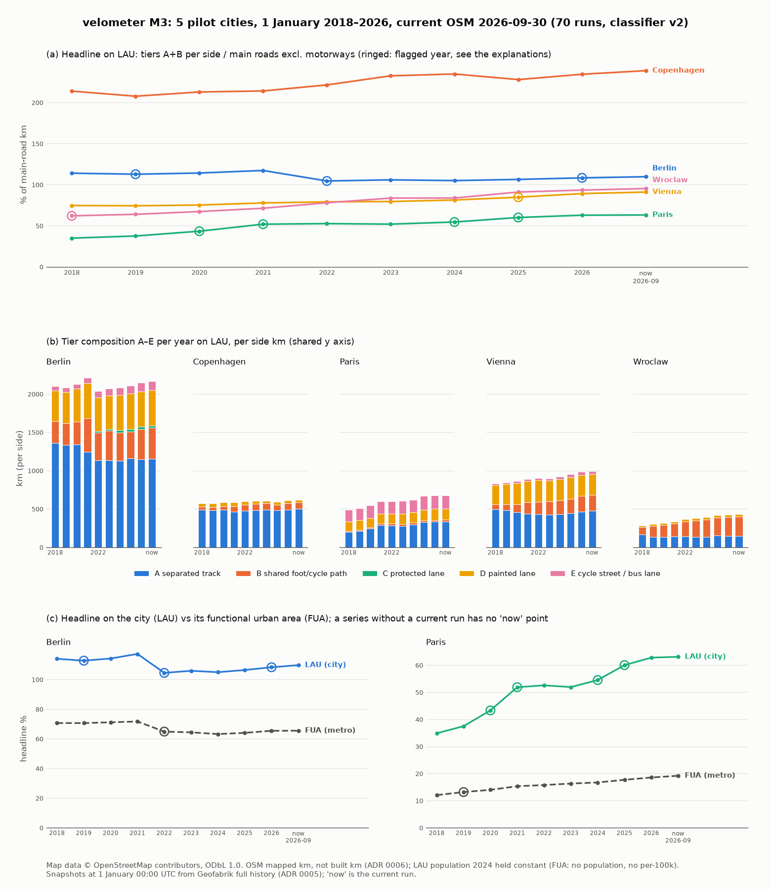

# M3 time series: yearly history per city and boundary

Generated by `velometer timeseries --write` from the yearly history runs (2018-2026) plus the
current run of each city. On LAU, population is held constant at the 2024 value across years;
FUA boundaries carry no population, so FUA series have no per-100k figure. Our numbers are OSM
*mapped* km (ADR 0006). The block between the markers is replaced on every
`--write`; everything outside it is hand-written.

Classifier: the series reports `report_classifier` from `config/report.yaml`, currently
**v2** (v1 plus recognised `use_sidepath`, `shoulder`, `crossing`, untyped `yes`, and `,` as a
value separator). The v1 runs stay in the database; `--classifier v1` shows them.

Flag rules (`config/activity.yaml`, spec section 2.13): `km_jump`, `activity_spike`,
`campaign_suspected`, `single_mapper`, `tag_drift`. Every flagged city-year needs an
explanation under a heading `### <city>/<kind>/<year>` (the current point is `current`) in the
Explanations section below; `velometer timeseries --check` enforces this.

Explained-against marker: the Explanations section carries one HTML comment naming, per
`city/kind`, the first 8 characters of the history set the explanations were written against.
When one differs, `--check` exits 1 and prints the corrected marker line. Since schema v6,
`config/activity.yaml` is part of the run identity (its sha256 is in `config_sha256` and keys
the activity rows), so a changed `activity.yaml` finds no runs and `--check` fails with "no
history runs"; the marker no longer names it. A series must hold every year of
`config/history.yaml` for each required kind; a missing year fails `--check`, and no change
rule compares across it.

The chart is drawn by `scripts/render_m3_timeseries.py` from the same series and flags. Since
M4 the FUA series also have a current ("now") point: the current run merges the public Geofabrik
extracts that cover the boundary (Berlin FUA: `brandenburg`; Paris FUA: `bourgogne`, `centre`,
`champagne-ardenne`, `haute-normandie`, `ile-de-france`, `picardie`), and its OSM timestamp is
the oldest of theirs (M4 spec section 3.2).

<!-- timeseries:begin -->

#### berlin/fua

Provenance: history runs 2018=199, 2019=200, 2020=201, 2021=202, 2022=203, 2023=204, 2024=205, 2025=206, 2026=207 · current run 152 (OSM 2026-09-30T20:22:42Z) · history set `1308e2c9` · classifier v2 `{"plain_cycleway_on_oneway":"traffic_side"}` · config `7416d3c8c103` · no population (per-100k n/a)

| year | headline % | A+B km | A | B | C | D | E | edits | mappers | top mapper | legacy km | unrecognised km | flags |
|---|---:|---:|---:|---:|---:|---:|---:|---:|---:|---:|---:|---:|---|
| 2018 | 70.6 | 3,750.8 | 2,336.0 | 1,414.9 | 0.0 | 502.8 | 92.8 | 25,269 | 609 | 0.23 | 29.3 | 16.2 |  |
| 2019 | 70.6 | 3,752.8 | 2,293.5 | 1,459.3 | 0.0 | 526.7 | 114.3 | 20,765 | 631 | 0.10 | 43.4 | 16.3 |  |
| 2020 | 71.1 | 3,790.4 | 2,267.5 | 1,523.0 | 0.0 | 559.4 | 119.0 | 20,737 | 611 | 0.14 | 51.3 | 21.0 |  |
| 2021 | 71.7 | 3,817.6 | 2,043.4 | 1,774.1 | 0.0 | 599.5 | 160.1 | 38,956 | 780 | 0.24 | 48.1 | 16.9 |  |
| 2022 | 64.8 | 3,469.6 | 1,560.9 | 1,908.7 | 18.8 | 598.6 | 187.4 | 77,158 | 982 | 0.50 | 73.0 | 9.1 | tag_drift |
| 2023 | 64.3 | 3,462.0 | 1,479.5 | 1,982.4 | 20.4 | 617.9 | 186.8 | 95,861 | 988 | 0.30 | 90.1 | 7.7 |  |
| 2024 | 63.2 | 3,393.8 | 1,399.7 | 1,994.1 | 38.2 | 631.1 | 218.7 | 105,709 | 887 | 0.16 | 88.9 | 6.7 |  |
| 2025 | 64.0 | 3,436.1 | 1,404.9 | 2,031.2 | 36.1 | 655.0 | 222.5 | 67,350 | 875 | 0.21 | 71.1 | 6.8 |  |
| 2026 | 65.4 | 3,520.4 | 1,381.0 | 2,139.4 | 37.0 | 656.5 | 252.5 | 114,033 | 925 | 0.13 | 46.3 | 5.2 |  |
| current | 65.4 | 3,523.3 | 1,372.4 | 2,151.0 | 34.0 | 657.4 | 258.1 | 31,183 | 728 | 0.09 | n/a | n/a |  |

#### berlin/lau

Provenance: history runs 2018=154, 2019=155, 2020=156, 2021=157, 2022=158, 2023=159, 2024=160, 2025=161, 2026=162 · current run 147 (OSM 2026-09-30T20:22:42Z) · history set `c3335f42` · classifier v2 `{"plain_cycleway_on_oneway":"traffic_side"}` · config `7416d3c8c103` · population 2024 held constant

| year | headline % | A+B km | A | B | C | D | E | edits | mappers | top mapper | legacy km | unrecognised km | flags |
|---|---:|---:|---:|---:|---:|---:|---:|---:|---:|---:|---:|---:|---|
| 2018 | 113.9 | 1,643.1 | 1,357.9 | 285.3 | 0.0 | 403.2 | 53.4 | 19,539 | 405 | 0.30 | 13.8 | 2.9 |  |
| 2019 | 112.7 | 1,615.0 | 1,335.7 | 279.3 | 0.0 | 410.4 | 58.0 | 15,715 | 411 | 0.13 | 24.7 | 3.0 | tag_drift |
| 2020 | 114.1 | 1,637.2 | 1,338.0 | 299.3 | 0.0 | 432.9 | 60.2 | 13,589 | 400 | 0.20 | 33.8 | 1.7 |  |
| 2021 | 117.2 | 1,680.7 | 1,243.3 | 437.4 | 0.0 | 456.4 | 72.1 | 23,420 | 511 | 0.27 | 29.2 | 1.1 |  |
| 2022 | 104.4 | 1,496.8 | 1,132.7 | 364.1 | 18.8 | 438.3 | 83.4 | 50,701 | 617 | 0.51 | 32.8 | 0.5 | km_jump, single_mapper |
| 2023 | 105.8 | 1,517.9 | 1,130.8 | 387.1 | 20.4 | 441.6 | 87.2 | 69,249 | 631 | 0.27 | 30.3 | 0.8 |  |
| 2024 | 104.9 | 1,493.8 | 1,129.3 | 364.5 | 33.1 | 455.8 | 97.1 | 84,863 | 592 | 0.20 | 27.3 | 0.3 |  |
| 2025 | 106.4 | 1,510.5 | 1,156.4 | 354.1 | 31.0 | 466.0 | 99.8 | 48,315 | 539 | 0.29 | 19.3 | 0.2 |  |
| 2026 | 108.3 | 1,539.4 | 1,144.1 | 395.3 | 31.8 | 461.1 | 111.9 | 93,469 | 605 | 0.14 | 3.9 | 0.1 | tag_drift |
| current | 109.6 | 1,558.0 | 1,151.3 | 406.7 | 28.9 | 461.6 | 115.2 | 22,645 | 460 | 0.12 | n/a | n/a |  |

#### copenhagen/lau

Provenance: history runs 2018=181, 2019=182, 2020=183, 2021=184, 2022=185, 2023=186, 2024=187, 2025=188, 2026=189 · current run 150 (OSM 2026-09-30T20:22:42Z) · history set `be41de5b` · classifier v2 `{"plain_cycleway_on_oneway":"traffic_side"}` · config `7416d3c8c103` · population 2024 held constant

| year | headline % | A+B km | A | B | C | D | E | edits | mappers | top mapper | legacy km | unrecognised km | flags |
|---|---:|---:|---:|---:|---:|---:|---:|---:|---:|---:|---:|---:|---|
| 2018 | 213.9 | 529.8 | 488.9 | 40.9 | 0.0 | 40.2 | 0.6 | 3,276 | 93 | 0.34 | 1.2 | 0.2 |  |
| 2019 | 207.7 | 522.8 | 481.4 | 41.4 | 0.0 | 49.8 | 0.6 | 2,776 | 81 | 0.18 | 1.2 | 0.0 |  |
| 2020 | 212.8 | 534.1 | 488.1 | 45.9 | 0.0 | 51.9 | 0.6 | 2,084 | 87 | 0.13 | 1.0 | 0.0 |  |
| 2021 | 214.1 | 535.8 | 460.8 | 75.0 | 0.0 | 51.0 | 0.6 | 2,866 | 70 | 0.28 | 1.0 | 0.0 |  |
| 2022 | 221.4 | 550.2 | 473.4 | 76.8 | 0.0 | 47.7 | 0.6 | 4,225 | 165 | 0.10 | 0.5 | 0.0 |  |
| 2023 | 232.5 | 566.4 | 484.8 | 81.6 | 0.0 | 38.7 | 1.9 | 5,093 | 151 | 0.26 | 0.4 | 0.2 |  |
| 2024 | 234.7 | 569.5 | 486.4 | 83.2 | 0.0 | 37.8 | 2.1 | 4,618 | 129 | 0.18 | 0.4 | 0.0 |  |
| 2025 | 227.9 | 556.2 | 482.5 | 73.7 | 0.0 | 37.4 | 3.6 | 5,573 | 131 | 0.26 | 0.4 | 0.0 |  |
| 2026 | 234.4 | 572.5 | 489.2 | 83.3 | 0.0 | 38.3 | 3.4 | 4,868 | 124 | 0.27 | 0.1 | 0.0 |  |
| current | 238.8 | 582.3 | 498.4 | 83.9 | 0.0 | 36.5 | 6.3 | 3,540 | 113 | 0.15 | n/a | n/a |  |

#### paris/fua

Provenance: history runs 2018=208, 2019=209, 2020=210, 2021=211, 2022=212, 2023=213, 2024=214, 2025=215, 2026=216 · current run 153 (OSM 2026-09-30T20:22:42Z) · history set `df7be7ff` · classifier v2 `{"plain_cycleway_on_oneway":"traffic_side"}` · config `7416d3c8c103` · no population (per-100k n/a)

| year | headline % | A+B km | A | B | C | D | E | edits | mappers | top mapper | legacy km | unrecognised km | flags |
|---|---:|---:|---:|---:|---:|---:|---:|---:|---:|---:|---:|---:|---|
| 2018 | 12.0 | 2,332.9 | 1,791.3 | 541.6 | 0.0 | 1,033.8 | 186.4 | 26,070 | 650 | 0.11 | 141.6 | 0.9 |  |
| 2019 | 13.2 | 2,576.7 | 1,889.2 | 687.5 | 0.0 | 1,132.9 | 197.8 | 38,570 | 798 | 0.10 | 165.7 | 0.6 | km_jump |
| 2020 | 14.0 | 2,738.7 | 1,943.8 | 794.9 | 0.0 | 1,172.6 | 207.8 | 42,515 | 907 | 0.05 | 116.2 | 0.4 |  |
| 2021 | 15.3 | 2,997.5 | 2,097.6 | 899.9 | 0.0 | 1,357.4 | 206.7 | 58,254 | 980 | 0.15 | 96.8 | 0.5 |  |
| 2022 | 15.7 | 3,087.8 | 2,039.0 | 1,048.8 | 0.0 | 1,394.3 | 221.2 | 65,830 | 1,180 | 0.05 | 76.5 | 4.5 |  |
| 2023 | 16.3 | 3,193.8 | 1,978.9 | 1,214.9 | 0.0 | 1,453.9 | 238.6 | 70,989 | 1,191 | 0.05 | 66.3 | 4.4 |  |
| 2024 | 16.7 | 3,279.3 | 1,947.1 | 1,332.1 | 0.0 | 1,505.9 | 252.8 | 130,960 | 1,055 | 0.21 | 65.3 | 3.3 |  |
| 2025 | 17.7 | 3,471.2 | 2,094.5 | 1,376.7 | 0.0 | 1,561.9 | 269.9 | 87,159 | 1,061 | 0.12 | 59.6 | 2.8 |  |
| 2026 | 18.5 | 3,627.5 | 2,152.3 | 1,475.2 | 0.0 | 1,602.4 | 270.2 | 84,399 | 1,138 | 0.04 | 40.0 | 3.1 |  |
| current | 19.2 | 3,751.1 | 2,135.4 | 1,615.7 | 0.0 | 1,679.0 | 288.0 | 81,747 | 1,020 | 0.11 | n/a | n/a |  |

#### paris/lau

Provenance: history runs 2018=163, 2019=164, 2020=165, 2021=166, 2022=167, 2023=168, 2024=169, 2025=170, 2026=171 · current run 148 (OSM 2026-09-30T20:22:42Z) · history set `7db1f306` · classifier v2 `{"plain_cycleway_on_oneway":"traffic_side"}` · config `7416d3c8c103` · population 2024 held constant

| year | headline % | A+B km | A | B | C | D | E | edits | mappers | top mapper | legacy km | unrecognised km | flags |
|---|---:|---:|---:|---:|---:|---:|---:|---:|---:|---:|---:|---:|---|
| 2018 | 34.8 | 208.6 | 196.9 | 11.7 | 0.0 | 127.4 | 151.0 | 3,887 | 172 | 0.17 | 49.1 | 0.0 |  |
| 2019 | 37.5 | 223.9 | 211.2 | 12.7 | 0.0 | 126.6 | 160.2 | 8,218 | 203 | 0.29 | 49.5 | 0.1 |  |
| 2020 | 43.3 | 257.3 | 241.1 | 16.2 | 0.0 | 122.4 | 168.5 | 8,422 | 237 | 0.22 | 8.2 | 0.2 | km_jump, tag_drift |
| 2021 | 51.9 | 305.6 | 286.4 | 19.1 | 0.0 | 129.9 | 160.7 | 9,206 | 223 | 0.31 | 3.4 | 0.2 | km_jump |
| 2022 | 52.5 | 309.1 | 282.0 | 27.1 | 0.0 | 131.0 | 158.5 | 8,421 | 322 | 0.21 | 3.3 | 0.5 |  |
| 2023 | 51.9 | 304.2 | 278.7 | 25.5 | 0.0 | 135.2 | 164.4 | 13,816 | 332 | 0.14 | 3.3 | 1.1 |  |
| 2024 | 54.5 | 318.6 | 294.6 | 24.0 | 0.0 | 134.7 | 163.9 | 70,335 | 330 | 0.39 | 4.7 | 1.1 | activity_spike |
| 2025 | 60.0 | 345.7 | 324.6 | 21.2 | 0.0 | 143.3 | 177.9 | 20,590 | 351 | 0.15 | 3.7 | 1.0 | activity_spike |
| 2026 | 62.8 | 355.2 | 334.1 | 21.1 | 0.0 | 145.5 | 172.5 | 16,317 | 316 | 0.19 | 2.2 | 0.6 |  |
| current | 63.1 | 356.5 | 335.1 | 21.4 | 0.0 | 147.1 | 174.8 | 7,114 | 253 | 0.17 | n/a | n/a |  |

#### vienna/lau

Provenance: history runs 2018=172, 2019=173, 2020=174, 2021=175, 2022=176, 2023=177, 2024=178, 2025=179, 2026=180 · current run 149 (OSM 2026-09-30T20:22:42Z) · history set `1254c077` · classifier v2 `{"plain_cycleway_on_oneway":"traffic_side"}` · config `7416d3c8c103` · population 2024 held constant

| year | headline % | A+B km | A | B | C | D | E | edits | mappers | top mapper | legacy km | unrecognised km | flags |
|---|---:|---:|---:|---:|---:|---:|---:|---:|---:|---:|---:|---:|---|
| 2018 | 74.6 | 558.5 | 495.2 | 63.3 | 0.0 | 251.5 | 18.3 | 7,790 | 199 | 0.33 | 97.1 | 0.0 |  |
| 2019 | 74.2 | 558.2 | 483.1 | 75.1 | 0.0 | 266.4 | 18.4 | 6,476 | 198 | 0.20 | 95.4 | 0.0 |  |
| 2020 | 75.2 | 562.8 | 454.6 | 108.2 | 0.0 | 276.1 | 21.5 | 6,493 | 183 | 0.19 | 96.0 | 0.0 |  |
| 2021 | 77.7 | 583.0 | 436.8 | 146.2 | 0.0 | 282.2 | 23.5 | 6,816 | 205 | 0.19 | 93.3 | 0.0 |  |
| 2022 | 79.0 | 592.1 | 433.5 | 158.6 | 0.0 | 284.7 | 23.4 | 11,001 | 280 | 0.10 | 67.4 | 0.0 |  |
| 2023 | 79.5 | 595.9 | 426.7 | 169.1 | 0.0 | 275.1 | 25.1 | 9,912 | 284 | 0.11 | 35.0 | 0.0 |  |
| 2024 | 81.3 | 608.1 | 427.5 | 180.6 | 0.0 | 280.9 | 30.9 | 19,190 | 293 | 0.18 | 23.1 | 0.0 |  |
| 2025 | 84.7 | 632.9 | 440.4 | 192.5 | 0.0 | 283.5 | 34.5 | 11,908 | 314 | 0.06 | 10.3 | 0.0 | tag_drift |
| 2026 | 89.1 | 667.4 | 465.8 | 201.6 | 0.0 | 275.8 | 40.0 | 17,709 | 329 | 0.30 | 8.0 | 0.2 |  |
| current | 91.0 | 679.8 | 474.7 | 205.1 | 0.0 | 273.2 | 41.1 | 10,872 | 276 | 0.19 | n/a | n/a |  |

#### wroclaw/lau

Provenance: history runs 2018=190, 2019=191, 2020=192, 2021=193, 2022=194, 2023=195, 2024=196, 2025=197, 2026=198 · current run 151 (OSM 2026-09-30T20:22:42Z) · history set `fda036ca` · classifier v2 `{"plain_cycleway_on_oneway":"traffic_side"}` · config `7416d3c8c103` · population 2024 held constant

| year | headline % | A+B km | A | B | C | D | E | edits | mappers | top mapper | legacy km | unrecognised km | flags |
|---|---:|---:|---:|---:|---:|---:|---:|---:|---:|---:|---:|---:|---|
| 2018 | 62.0 | 261.5 | 167.7 | 93.8 | 0.0 | 22.3 | 0.0 | 22,113 | 81 | 0.89 | 4.1 | 0.0 | activity_spike |
| 2019 | 63.9 | 272.7 | 132.0 | 140.7 | 0.0 | 26.1 | 0.0 | 9,634 | 68 | 0.89 | 4.0 | 0.0 |  |
| 2020 | 67.2 | 288.5 | 133.5 | 154.9 | 0.0 | 27.7 | 0.0 | 5,642 | 76 | 0.60 | 3.5 | 0.0 |  |
| 2021 | 71.2 | 306.0 | 138.0 | 168.0 | 0.0 | 29.7 | 0.2 | 6,466 | 73 | 0.41 | 2.9 | 0.0 |  |
| 2022 | 77.9 | 333.6 | 143.2 | 190.4 | 0.0 | 31.0 | 0.2 | 8,599 | 148 | 0.46 | 2.0 | 0.0 |  |
| 2023 | 83.6 | 348.1 | 132.2 | 215.9 | 0.0 | 31.8 | 0.7 | 14,168 | 126 | 0.65 | 1.9 | 0.0 |  |
| 2024 | 83.7 | 362.3 | 135.2 | 227.1 | 0.0 | 31.2 | 0.7 | 8,262 | 126 | 0.59 | 2.1 | 0.0 |  |
| 2025 | 91.0 | 386.3 | 151.0 | 235.3 | 0.1 | 31.9 | 0.7 | 7,437 | 148 | 0.28 | 0.0 | 1.4 |  |
| 2026 | 93.3 | 390.6 | 148.8 | 241.9 | 0.1 | 31.5 | 0.8 | 8,419 | 128 | 0.29 | 0.0 | 0.0 |  |
| current | 95.3 | 398.6 | 148.7 | 250.0 | 0.1 | 32.3 | 0.8 | 6,763 | 106 | 0.41 | n/a | n/a |  |

<!-- timeseries:end -->

## Explanations

How to read `tag_drift` here: the rule fires when `legacy_km` or `unrecognised_km` changes by
at least 50% and by at least 5 km (`tag_drift_min_km`, scaled for the current point). The km
floor was added on 2026-10-02: without it, 18 further city-years were flagged for moves of a few
km or less, down to 0.1 -> 0.2 km. Way ids are OSM way ids; tag changes are quoted
before -> after.

<!-- explained-against: berlin/fua=1308e2c9 berlin/lau=c3335f42 copenhagen/lau=be41de5b paris/fua=df7be7ff paris/lau=7db1f306 vienna/lau=1254c077 wroclaw/lau=fda036ca -->

### berlin/lau/2019

Cause: **tag drift**. `legacy_km` rose 13.8 -> 24.7 because mappers added the older
`sidewalk:*:bicycle=yes` scheme to main roads (rule `X_sidewalk_bicycle_permitted`, 4.3 ->
15.9 km), e.g. way 144884824 and way 31099696 (secondary roads that gained
`sidewalk:both:bicycle=yes`, 2.5 and 2.2 km). Those sides are excluded from the tiers, so the
headline is unaffected (A+B 1,643 -> 1,615 km, below the jump threshold).

### berlin/lau/2022

Cause: **campaign** (re-mapping of sidepaths and of "sidewalk, bicycles permitted" ways), not a
loss of built infrastructure. A+B fell 1,680.7 -> 1,496.8 km: 191 km of road sides went from
`cycleway=track` to `cycleway=separate` (e.g. way 155594970, way 193875622), with only part of
the separate ways drawn by 1 January 2022 (+121 km of new `highway=cycleway`); and 127 km of
tier B left because `highway=path` + `bicycle=designated` became `highway=footway` +
`bicycle=yes` (e.g. way 354012617, way 699975735), which the classifier correctly does not
count. The year's 50,701 edits (2.2x 2021) are led by `highway=footway` creation,
`cycleway:both=no` and `cycleway:right=track -> separate`; one mapper made 51% of them
(`single_mapper`).

### berlin/lau/2026

Cause: **tag drift** (legacy clean-up). `legacy_km` 19.3 -> 3.9: `cycleway=opposite` on tiered
sides was removed during 2025 (9.0 -> 0.0 km, e.g. way 4787341 on a
`bicycle_road`), and `sidewalk:*:bicycle=yes` fell 9.9 -> 3.1 km (way 111283473 ->
`cycleway:both=no`). The new `cycleway:*=crossing` value on road sides (e.g. way 1133761372
`cycleway:right=lane` -> `crossing`) is recognised by v2 (excluded, subtype `crossing`), so it
no longer shows as unrecognised. Headline km rose normally (A+B 1,510 -> 1,539).

### berlin/fua/2022

Cause: **campaign**, the same sidepath re-mapping as berlin/lau/2022 extended into Brandenburg.
`legacy_km` 48.1 -> 73.0 because `sidewalk:both:bicycle=yes` on rural main roads grew 41.1 ->
67.6 km; road sides moved from `cycleway=right`/`use_sidepath` to `cycleway:right=separate`
(way 206903446, 3.8 km; way 449341004); `unrecognised_km` fell 16.9 -> 9.1 (v2). A+B fell
3,817.6 -> 3,469.6
km (-9.1%, below the 10% jump threshold) with 77,158 edits and a top-mapper share of 0.50.

### paris/lau/2020

Cause: **construction**, with **tag drift** in the legacy diagnostic. A+B rose 223.9 -> 257.3
km, almost all from 357 new `highway=cycleway` ways (+40.8 km, e.g. way 744744226, way
701119869) and 53 new roads with `cycleway=track` (+5.6 km) drawn during 2019, the Plan Vélo
build-out; activity was normal (8,422 edits, top mapper 0.22). `legacy_km` 49.5 -> 8.2 is
contraflow retagging: `cycleway=opposite_lane` 44.3 -> 6.4 km (way 25599714 ->
`cycleway:left=opposite`).

### paris/lau/2021

Cause: **construction** (the 2020 temporary "coronapistes"). A+B rose 257.3 -> 305.6 km: +29.3
km of new `highway=cycleway` ways (way 840939982) and roads gaining `cycleway=track` with
`cycleway:temporary=yes` (way 31823633, way 41872851 `share_busway` -> `track`, way 31956307
`lane` -> `track`). `legacy_km` 8.2 -> 3.4 is the end of the `opposite_lane` retagging (way
24709554).

### paris/lau/2024

Cause: **campaign** (pedestrian network, not cycling). 70,335 counted edits in 2023 against a
median of 9,206: 60,239 of them create `highway=footway` ways (e.g. way 4527565), 34,099 in July
2023 alone, spread over 3,910 changesets (top changeset 1.2%), top-mapper share 0.39. Footways
count as cycling-relevant edits in `config/activity.yaml` but carry no tier, so A+B moved
normally (+14.4 km).

### paris/lau/2025

Cause: **campaign**, the tail of the 2023 footway mapping. 20,590 edits in 2024 (limit 18,412):
8,307 `highway=footway` creations plus 2,675 new `highway=cycleway` ways (e.g. way 4039351) and
1,504 `cycleway:both=no` additions; top-mapper share 0.15, so no single-mapper effect. A+B
rose 318.6 -> 345.7 km (+8.5%, below the jump threshold), consistent with real build-out.

### paris/fua/2019

Cause: **construction** with ordinary catch-up mapping, not a campaign or import. A+B rose
2,332.9 -> 2,576.7 km (+10.5%): 1,336 new `highway=cycleway` ways (+236 km, e.g. way
597170301), +71 km of new `highway=path` + `bicycle=designated`, and 51 km of tier B from
`bicycle=yes` -> `designated` (way 107496601); partly offset by 65 km of `cycleway=track`
removed from roads (way 188144495) and 59 km of deleted cycleways. The 38,570 edits are spread
over 10,445 changesets (top changeset 1.4%, top-mapper share 0.10) and are not a spike.

### vienna/lau/2025

Cause: **tag drift**. `legacy_km` 23.1 -> 10.3 as `cycleway=opposite_lane` fell 21.8 -> 9.4 km
(way 206839268 -> `oneway:bicycle=no`; way 8043778 -> `cycleway:left=opposite`). The
retagging touches tier D only; A+B rose 608 -> 633 km.

### wroclaw/lau/2018

Cause: **campaign** by one mapper (pedestrian network). 22,113 counted edits in 2017 against a
median of 8,419: 14,617 create `highway=footway` (e.g. way 24964920) and 15,708 of all counted edits fall in
June–August 2017, with a top-mapper share of 0.89 across 2,783 changesets. 2018 is the first
point, so no km change can be attributed; A+B grew steadily afterwards (261.5 -> 272.7 km).

